<p align="center">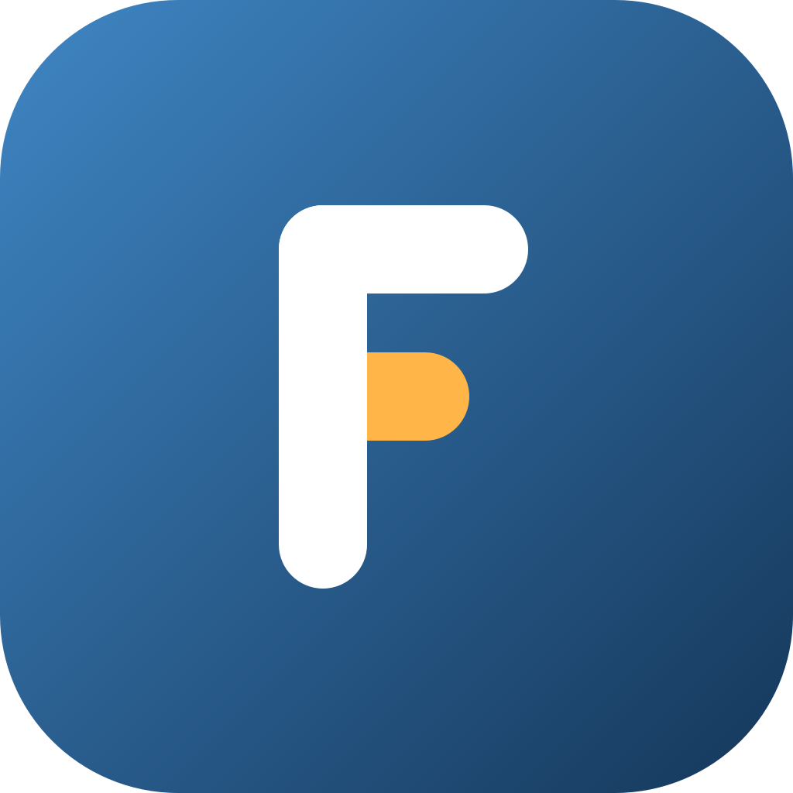</p>

# One Feed

One Kotlin codebase, news on Android, iOS, desktop and web. A Kotlin Multiplatform learning project: a news reader backed by a small Ktor server that fetches the New York Times Top Stories API and saves the stories in a PostgreSQL database.

**Live demo:** [one-feed.onrender.com](https://one-feed.onrender.com/) · [web app](https://one-feed.onrender.com/app/)

**Download:** [latest release](https://github.com/rks369/one-feed/releases/latest) with the Android APK, Windows installer and portable zip

## What it does

- Shows NYT top stories by section in Compose Multiplatform
- Saves bookmarks on the device with SQLDelight (in memory on web)
- Light, dark and system theme
- Ktor server that keeps the API key off the clients and stores stories in PostgreSQL
- Server-rendered HTML pages with section tabs, for search engines

## Screenshots

### Android

<p align="center">
  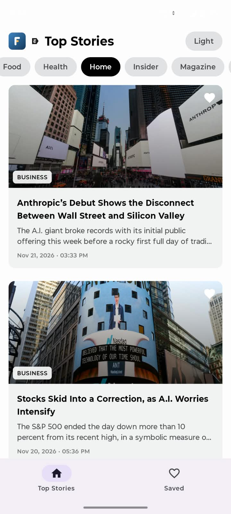
  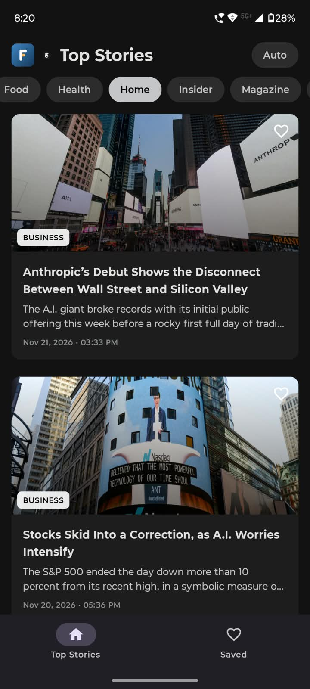
</p>
<p align="center"><sub>Top stories · light and dark</sub></p>

<p align="center">
  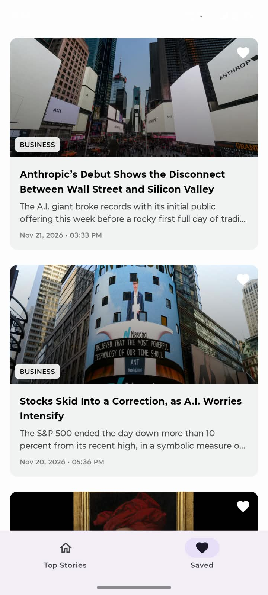
  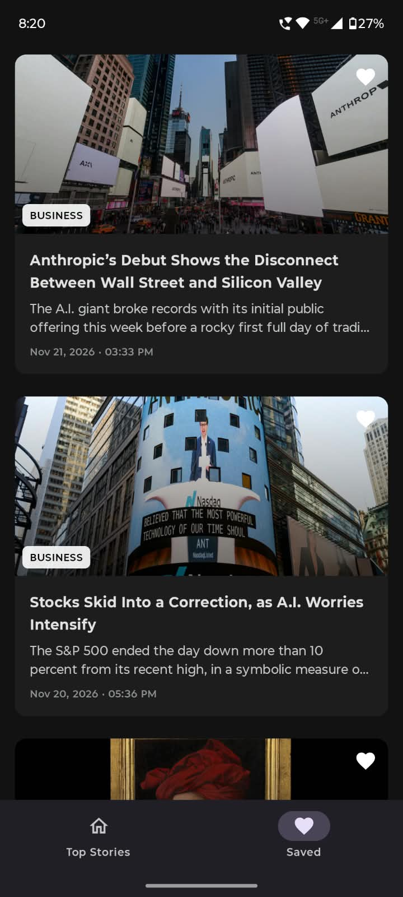
</p>
<p align="center"><sub>Saved tab · light and dark</sub></p>

### Desktop

<p align="center">
  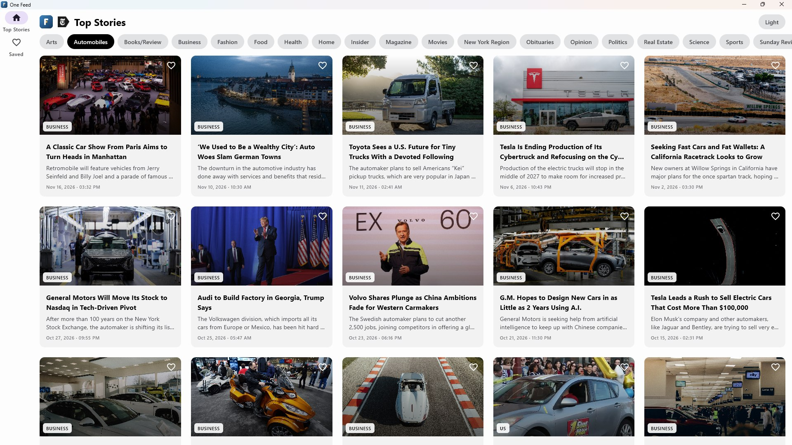
  <br><sub>Top stories · light</sub>
</p>

<p align="center">
  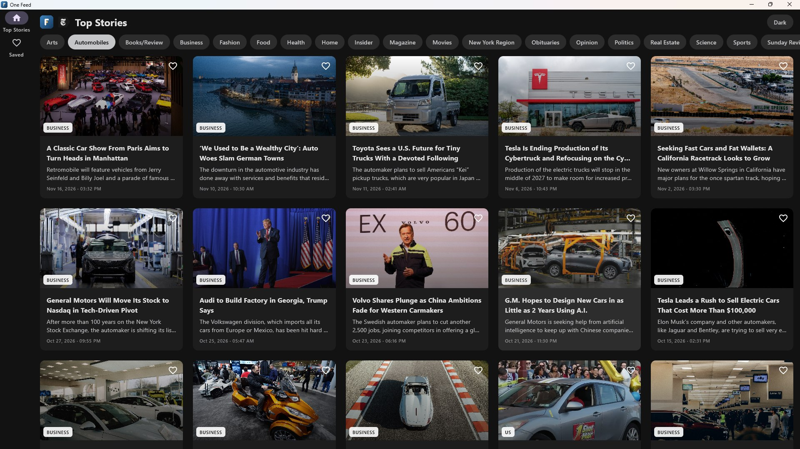
  <br><sub>Top stories · dark</sub>
</p>

In a narrow window the same app switches to the phone layout:

<p align="center">
  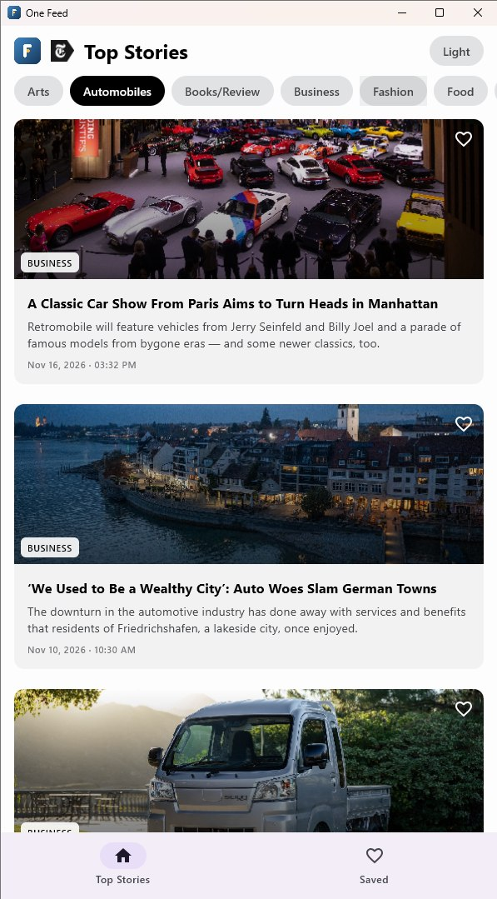
  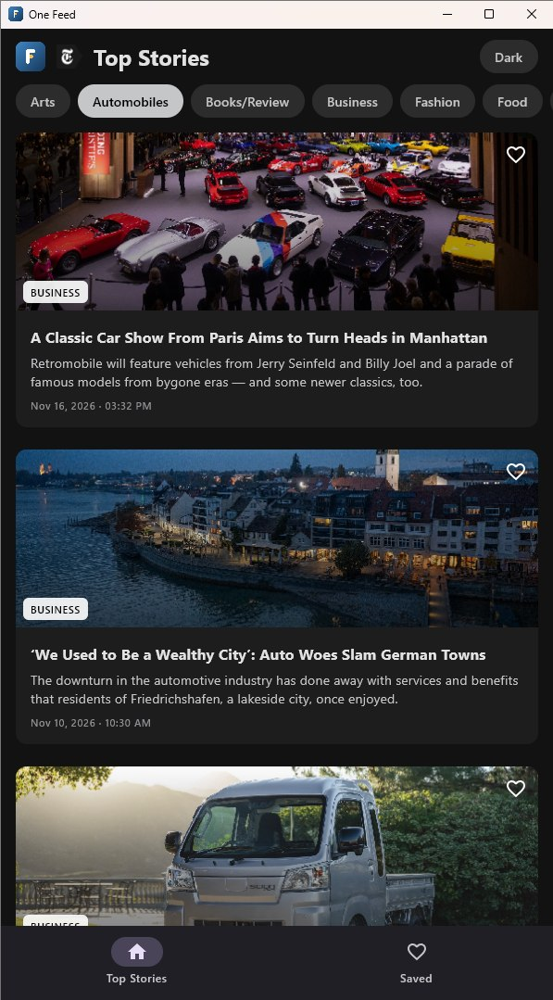
</p>
<p align="center"><sub>Narrow window · light and dark</sub></p>

### Web app

<p align="center">
  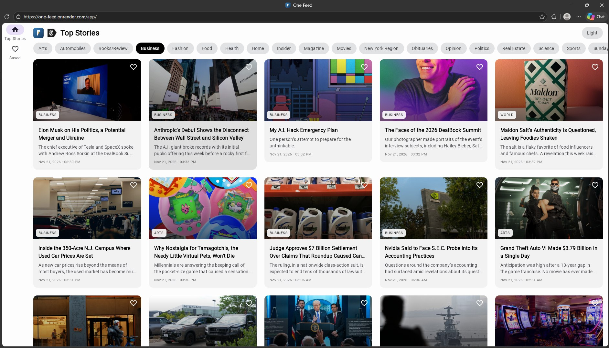
  <br><sub>Top stories · light</sub>
</p>

<p align="center">
  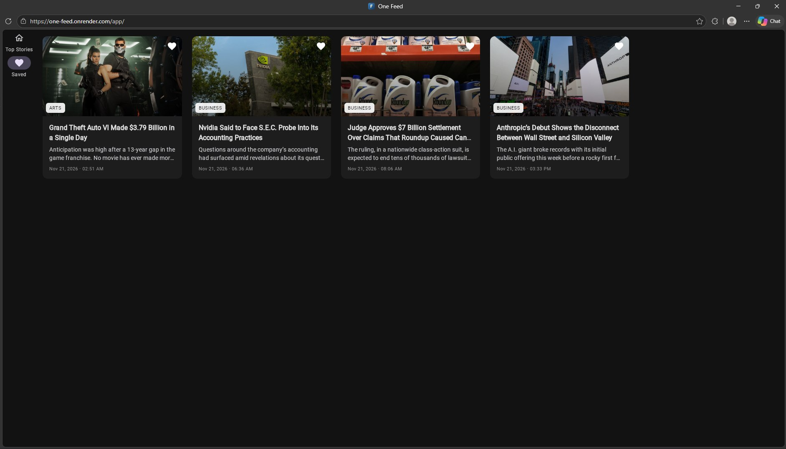
  <br><sub>Saved tab · dark</sub>
</p>

### Server-rendered page

<p align="center">
  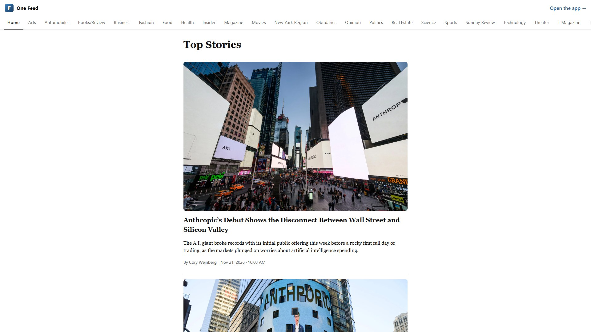
  <br><sub>Desktop width · light</sub>
</p>

<p align="center">
  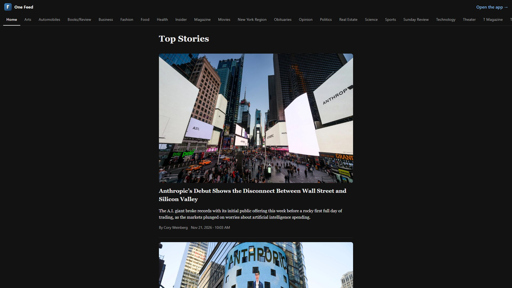
  <br><sub>Desktop width · dark</sub>
</p>

<p align="center">
  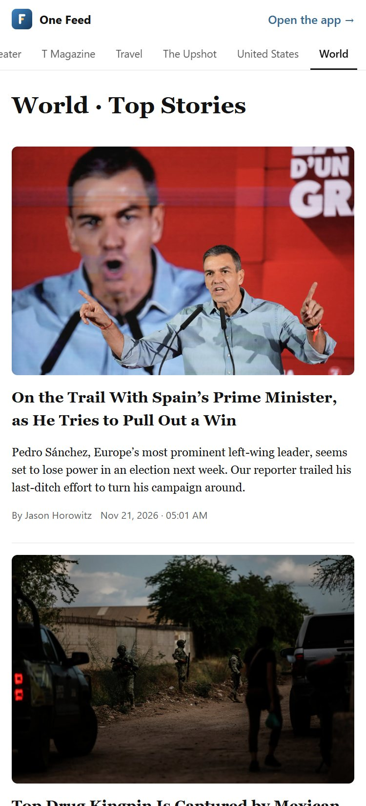
  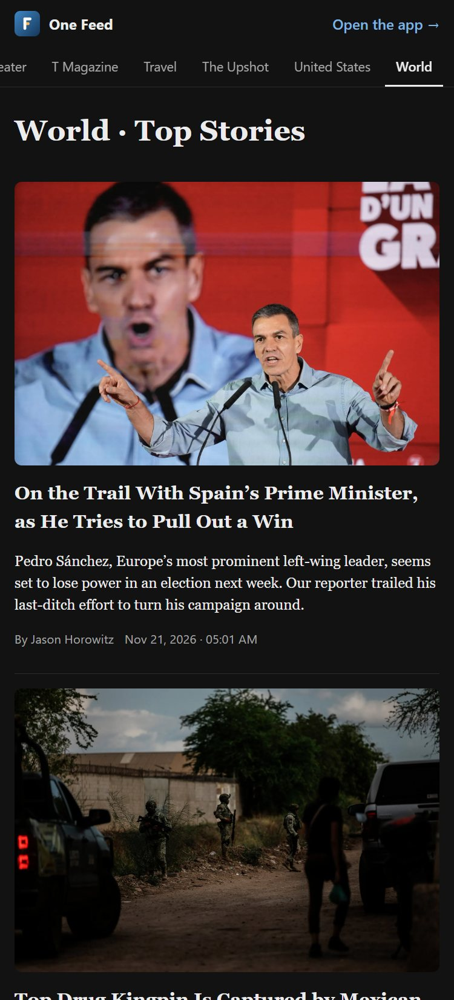
</p>
<p align="center"><sub>Phone width · light and dark</sub></p>

## How it works

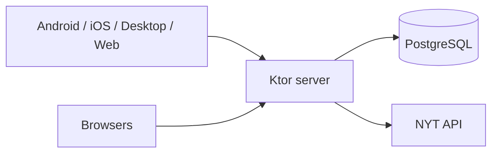

When a section is requested, the server checks Postgres:

- Saved less than 10 minutes ago: the stories come straight from the database.
- Older or missing: the server calls NYT, saves the result and returns it.
- NYT fails: the server returns whatever is already saved.

## Project layout

```
one-feed/
├── core/            Code shared by the apps and the server (Article, Sections, AppException)
├── server/          Ktor server: API, Postgres, HTML pages
├── app/
│   ├── shared/      Compose UI, ViewModels, repositories
│   ├── androidApp/
│   ├── iosApp/
│   ├── desktopApp/
│   └── webApp/
├── render.yaml      Render deployment
└── Dockerfile
```

## Running locally

You need JDK 17+, a PostgreSQL database (local or hosted) and a free NYT key from [developer.nytimes.com](https://developer.nytimes.com/).

1. Copy `server/local.properties.example` to `server/local.properties` and fill in `NYT_API_KEY` and `DATABASE_URL`. For a hosted database, use the host, user and password from your provider (see the example file).
2. For Android, copy `local.properties.example` to `local.properties` and set `sdk.dir`.

From the repository root:

| Target | Command |
|---|---|
| Server | `./gradlew :server:run` → http://localhost:8080 |
| Web | `./gradlew :app:webApp:wasmJsBrowserDistribution`, then run the server and open http://localhost:8080/app/ |
| Android | `./gradlew :app:androidApp:installDebug` (talks to `10.0.2.2:8080`) |
| Desktop | `./gradlew :app:desktopApp:run` (talks to `localhost:8080`) |
| iOS | Open `app/iosApp/iosApp.xcodeproj` in Xcode |

Release builds talk to `RELEASE_API_BASE_URL` in `app/shared/src/commonMain/kotlin/org/rks369/news/network/ApiConfig.kt`.

## Server endpoints

| Path | Returns |
|---|---|
| `/health` | `{"status":"ok"}` |
| `/api/sections` | All sections |
| `/api/top-stories/{section}` | Stories for one section |
| `/` and `/section/{key}` | HTML pages |
| `/app/` | The web app |

## Deploying

The `Dockerfile` builds the web app and the server into one image, so any host that can run a container will do. The demo currently runs on Render with a PostgreSQL database on TiDB Cloud.

On Render: choose **New → Blueprint**, pick this repository (`render.yaml` sets everything up) and set `NYT_API_KEY` and `DATABASE_URL` when asked.

Elsewhere: run the image with `NYT_API_KEY` and `DATABASE_URL` set. `PORT` is optional and defaults to 8080.

## Tech

Kotlin, Compose Multiplatform, Ktor (client and server), kotlinx.serialization, SQLDelight (SQLite on devices, PostgreSQL on the server), kotlinx.html, Docker.

## License

Free for personal, educational and non-commercial use under the [PolyForm Noncommercial License 1.0.0](LICENSE). For commercial use, contact me at riteshsaini331@gmail.com.

## Credits

Data provided by [The New York Times](https://developer.nytimes.com).

Ritesh · [github.com/rks369](https://github.com/rks369) · [linkedin.com/in/rks369](https://linkedin.com/in/rks369)
