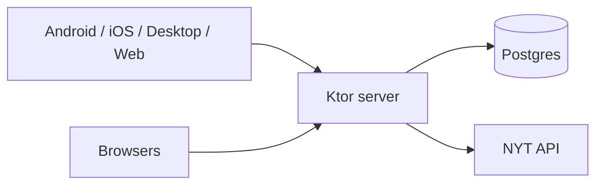

# OneFeed

One Kotlin codebase, news on Android, iOS, desktop and web. A Kotlin Multiplatform learning project: a news reader backed by a small Ktor server that fetches the New York Times Top Stories API and saves the stories in Postgres.

## What it does

- Shows NYT top stories by section in Compose Multiplatform
- Saves bookmarks on the device with SQLDelight (in memory on web)
- Light, dark and system theme
- Ktor server that keeps the API key off the clients and stores stories in Postgres
- Server-rendered HTML pages with section tabs, for search engines

## How it works



When a section is requested, the server checks Postgres:

- Saved less than 10 minutes ago: the stories come straight from the database.
- Older or missing: the server calls NYT, saves the result and returns it.
- NYT fails: the server returns whatever is already saved.

## Project layout

```
onefeed/
├── core/            Code shared by the apps and the server (Article, Sections, AppException)
├── server/          Ktor server: API, Postgres, HTML pages
├── app/
│   ├── shared/      Compose UI, ViewModels, repositories
│   ├── androidApp/
│   ├── iosApp/
│   ├── desktopApp/
│   └── webApp/
├── render.yaml      Render deployment
└── Dockerfile
```

## Running locally

You need JDK 17+, a Postgres database (local, or free from [Neon](https://neon.tech) / [Supabase](https://supabase.com)) and a free NYT key from [developer.nytimes.com](https://developer.nytimes.com/).

1. Copy `server/local.properties.example` to `server/local.properties` and fill in `NYT_API_KEY` and `DATABASE_URL`.
2. For Android, copy `local.properties.example` to `local.properties` and set `sdk.dir`.

From the repository root:

| Target | Command |
|---|---|
| Server | `./gradlew :server:run` → http://localhost:8080 |
| Web | `./gradlew :app:webApp:wasmJsBrowserDistribution`, then run the server and open http://localhost:8080/app/ |
| Android | `./gradlew :app:androidApp:installDebug` (talks to `10.0.2.2:8080`) |
| Desktop | `./gradlew :app:desktopApp:run` (talks to `localhost:8080`) |
| iOS | Open `app/iosApp/iosApp.xcodeproj` in Xcode |

Release builds talk to `RELEASE_API_BASE_URL` in `app/shared/src/commonMain/kotlin/org/rks369/news/network/ApiConfig.kt`.

## Server endpoints

| Path | Returns |
|---|---|
| `/health` | `{"status":"ok"}` |
| `/api/sections` | All sections |
| `/api/top-stories/{section}` | Stories for one section |
| `/` and `/section/{key}` | HTML pages |
| `/app/` | The web app |

## Deploying to Render

1. In Render choose **New → Blueprint** and pick this repository (`render.yaml` sets everything up).
2. Set `NYT_API_KEY` and `DATABASE_URL` when asked.

## Tech

Kotlin, Compose Multiplatform, Ktor (client and server), kotlinx.serialization, SQLDelight (SQLite on devices, PostgreSQL on the server), kotlinx.html, Docker, Render.

## Credits

Data provided by [The New York Times](https://developer.nytimes.com).

Ritesh · [github.com/rks369](https://github.com/rks369) · [linkedin.com/in/rks369](https://linkedin.com/in/rks369)
